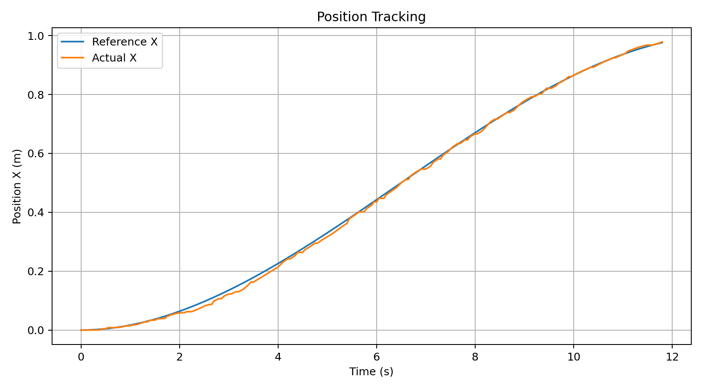
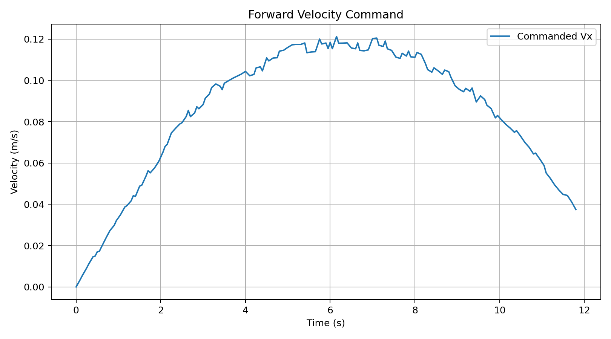
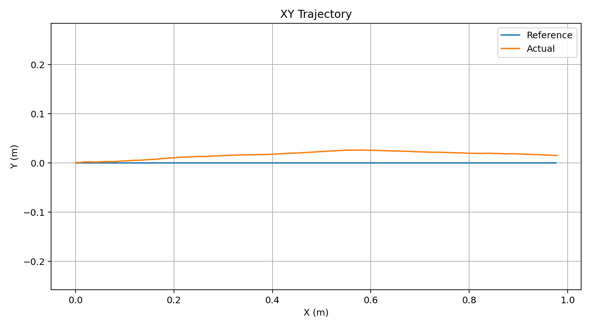
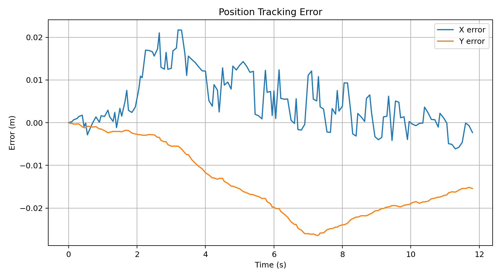
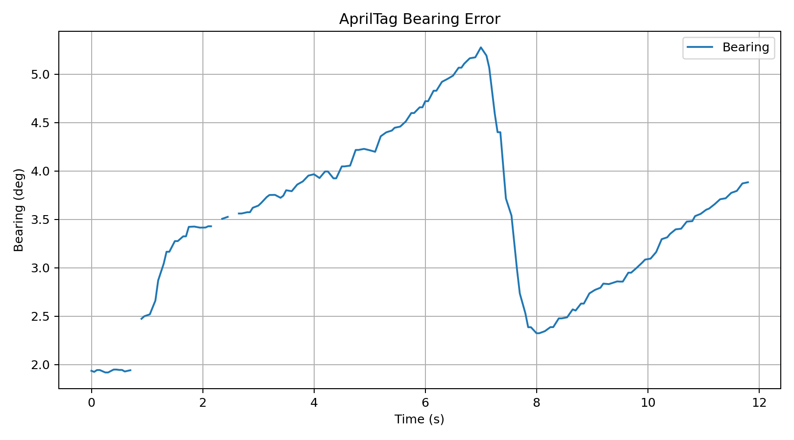
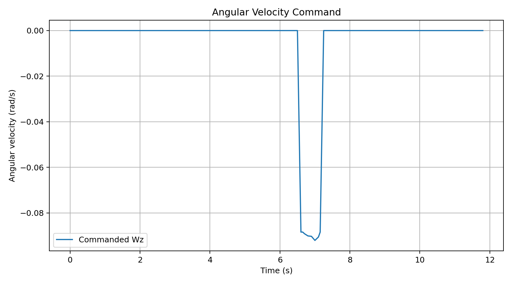

# RoboMaster EP - AprilTag-Guided Cubic Trajectory Pursuit

**SCE 672 - Assessment 2**  
**Author:** Muhammad Qaisar Ali  
**Platform:** RoboMaster EP | ROS 2 Jazzy | Ubuntu 24.04 (WSL2)

## Overview

The RoboMaster EP searches for a selected AprilTag, aligns using camera bearing, and tracks a cubic longitudinal trajectory with odometry feedback. The validated experiment uses **SEARCHING → ALIGNING → CHASING → ARRIVED**.

## Experimental Setup

The tag distance was measured manually. The camera estimates tag ID and horizontal bearing, not distance; no ToF sensor is used. At the end of alignment, the robot's current odometry pose defines a local frame with its forward heading as the positive X-axis.

| Parameter | Tested value |
|---|---|
| Target | AprilTag 3 |
| Initial target distance | 1.30 m |
| Nominal standoff | 0.30 m |
| Planned travel | **1.00 m** |
| Duration | 13 s |
| Initial and final reference speed | 0 m/s |
| Lateral reference | 0 m |
| Automatic return | Disabled |

The standoff is relative to the odometry reference point; physical front-bumper clearance was not independently verified.

## Running the Experiment

Use the external [RoboMaster ROS 2 driver](https://github.com/jeguzzi/robomaster_ros). Source ROS 2 Jazzy and the workspace in each terminal before running the following commands.

**Terminal 1 — Driver:**

```bash
ros2 launch robomaster_ros ep.launch conn_type:=sta
```

**Terminal 2 — Enable video:**

```bash
ros2 param set /robomaster camera.video.raw 1
```

**Terminal 3 — Detector:**

```bash
ros2 run rm_flatness_nav apriltag_detector --ros-args -p target_id:=3
```

**Terminal 4 — Planner (tested command):**

```bash
ros2 run rm_flatness_nav planner \
  --ros-args \
  -p target_id:=3 \
  -p tag_distance:=1.3 \
  -p standoff:=0.30 \
  -p duration:=13.0 \
  -p auto_return:=false
```

Only one motion controller should publish `/cmd_vel`. Ctrl+C attempts to send zero-velocity commands, but this is not a hardware emergency stop or a crash-proof watchdog.

## 1. Where Is the Path Planned?

**Source code:**

- [Cubic boundary-value solver - `cubic()`](rm_flatness_nav/planner.py#L18-L27)
- [Trajectory position and velocity - `evaluate()`](rm_flatness_nav/planner.py#L29-L35)
- [Cubic trajectory initialization](rm_flatness_nav/planner.py#L71)
- [SEARCHING state](rm_flatness_nav/planner.py#L201-L211)
- [ALIGNING state](rm_flatness_nav/planner.py#L212-L231)
- [CHASING - trajectory tracking and bearing correction](rm_flatness_nav/planner.py#L232-L270)

The cubic trajectory is

$$
x(t)=\alpha_0+\alpha_1t+\alpha_2t^2+\alpha_3t^3.
$$

The four endpoint conditions are

$$
x(0)=0,\quad \dot{x}(0)=0,\quad x(T)=D,\quad \dot{x}(T)=0.
$$

The coefficients are obtained with `numpy.linalg.solve` from

$$
\begin{bmatrix}
1&0&0&0\\
0&1&0&0\\
1&T&T^2&T^3\\
0&1&2T&3T^2
\end{bmatrix}
\begin{bmatrix}
\alpha_0\\
\alpha_1\\
\alpha_2\\
\alpha_3
\end{bmatrix}
=
\begin{bmatrix}
0\\
0\\
D\\
0
\end{bmatrix}.
$$

For the tested experiment, $D=1.00\,\mathrm{m}$ and $T=13\,\mathrm{s}$. Thus,

$$
x_{\mathrm{ref}}(t)=D\left[3\left(\frac{t}{T}\right)^2-2\left(\frac{t}{T}\right)^3\right]
$$

and its derivative is

$$
v_{\mathrm{ref}}(t)=\frac{6D}{T}\left(\frac{t}{T}\right)\left(1-\frac{t}{T}\right),\qquad y_{\mathrm{ref}}(t)=0.
$$

The [`cubic()` function](rm_flatness_nav/planner.py#L18-L27) solves the boundary-value problem, while [`evaluate()`](rm_flatness_nav/planner.py#L29-L35) evaluates the reference position and speed.

## 2. Where Are Commands Sent to RoboMaster?

**Source code:**

- [ROS 2 `/cmd_vel` publisher](rm_flatness_nav/planner.py#L90)
- [Main planner control loop](rm_flatness_nav/planner.py#L180-L324)
- [CHASING velocity commands](rm_flatness_nav/planner.py#L232-L270)
- [Publishing velocity commands to RoboMaster](rm_flatness_nav/planner.py#L324)

**AprilTag perception:**

- [Camera image processing](rm_flatness_nav/apriltag_detector.py#L95)
- [AprilTag detection using OpenCV](rm_flatness_nav/apriltag_detector.py#L138)
- [Publishing the target bearing](rm_flatness_nav/apriltag_detector.py#L245)

The planner creates a `geometry_msgs/msg/Twist` publisher on `/cmd_vel`:

```python
self.cmd_pub = self.create_publisher(Twist, "/cmd_vel", 10)
```

During CHASING, longitudinal motion uses cubic feedforward plus odometry position feedback:

$$
v_x=\operatorname{sat}\left(v_{\mathrm{ref}}+K_x(x_{\mathrm{ref}}-x_{\mathrm{actual}})\right).
$$

The camera bearing supplies angular correction when the bearing exceeds the controller deadband. The lateral command is zero.

Commands are transmitted with:

```python
cmd.linear.x = ...
cmd.angular.z = ...
self.cmd_pub.publish(cmd)
```

The external `robomaster_ros` driver converts `/cmd_vel` into chassis commands.

| Topic | Function |
|---|---|
| `/camera/image_color` | Camera image |
| `/tag/bearing` | Target horizontal bearing |
| `/tag/detected` | Selected tag detection |
| `/odom` | Chassis odometry |
| `/cmd_vel` | Chassis motion command |
| `/planner/state` | Mission state |

## 3. Reference X and Velocity Graphs

### Reference Versus Actual X Position



The actual odometry position follows the cubic reference closely.

### Forward Velocity Command



**Note:** This graph shows the *commanded* velocity (reference plus feedback), not the pure analytic cubic derivative or independently measured speed.

## 4. Tracking Errors and Bearing Correction

### XY Trajectory



The nominal lateral position is zero, while the actual path has a small lateral deviation.

### Longitudinal and Lateral Tracking Errors

$$
e_x(t)=x_{\mathrm{ref}}(t)-x_{\mathrm{actual}}(t),\qquad
e_y(t)=y_{\mathrm{ref}}(t)-y_{\mathrm{actual}}(t).
$$



The X error is mostly within approximately 2 cm, while lateral deviation peaks near 2.6 cm. These are odometry-based estimates, not independent ground truth.

### AprilTag Bearing Error



### Angular Velocity Command



The angular command is mostly zero, with a short correction during CHASING.

## 5. Course YouTube Demonstration

**Video:** [RoboMaster EP demonstration](https://www.youtube.com/watch?v=2N3eMX02lTQ)


## Repository Layout

```text
rm_flatness_nav/
├── rm_flatness_nav/
│   ├── __init__.py
│   ├── apriltag_detector.py
│   └── planner.py
├── results/
│   └── mission_20261105_101546/
│       ├── mission_20261105_101546_01_position.png
│       ├── mission_20261105_101546_02_xy_trajectory.png
│       ├── mission_20261105_101546_03_velocity.png
│       ├── mission_20261105_101546_04_tracking_error.png
│       ├── mission_20261105_101546_05_bearing.png
│       └── mission_20261105_101546_06_angular_velocity.png
├── plot_mission.py
├── package.xml
├── setup.py
├── setup.cfg
└── README.md
```

The planner logs to `~/robomaster_ws/logs/mission_*.csv`. The raw CSV was not supplied with the shared results; the figures above are the recorded experimental plots.

## Dependencies

ROS 2 Jazzy (`rclpy`, `geometry_msgs`, `sensor_msgs`, `nav_msgs`, `std_msgs`), Python 3.12, NumPy, OpenCV with `cv2.aruco`, Matplotlib, and the separately installed [RoboMaster ROS 2 driver](https://github.com/jeguzzi/robomaster_ros).